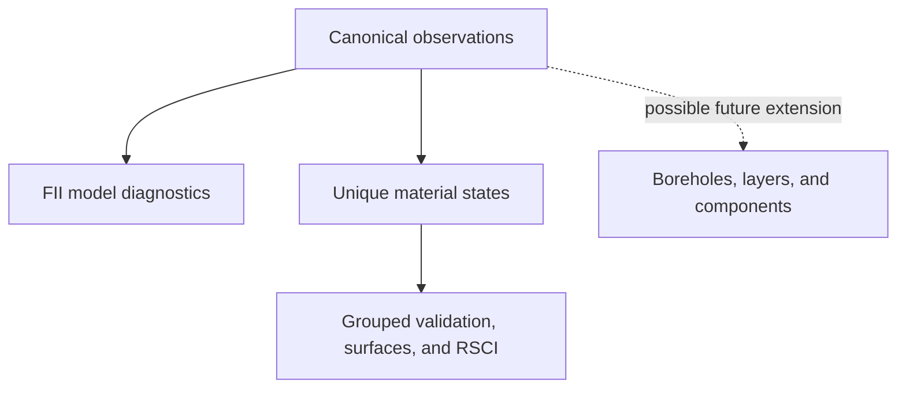

# Common data model for thermal-conductivity software workflows

Status: final public release 2.0.0, 2026-09-16  
Scope: the FII surrogate-model diagnostic workflow, the lithology-specific
response-surface and RSCI workflow, and ontology planning for a possible future
spatial-transfer workflow. This document does not define or contain that future
implementation.

## Design rule

The public reproducibility boundary begins at a normalised analytical table:

```text
private or source-specific preparation
    -> canonical public input
    -> method-specific scientific workflow
```

Source-system field names, database joins, institutional identifiers, and
project-specific extraction logic are not part of either public package.

## Entity flow



The branches are conceptual contracts, not a claim that one package's output
must be used as another package's input. The packages share physical vocabulary
and identifier semantics but remain independently versioned and citable.

## Canonical physical vocabulary

Public column names are explicit and unit-bearing. Mathematical abbreviations
such as `w`, `rho_b`, `rho_d`, `rho_s`, and `lambda` may be used inside formulas
or local numerical arrays, but not as public input-column names.

| Canonical field | Unit / values | Meaning | FII workflow | RSCI workflow | Possible spatial extension |
|---|---|---|---:|---:|---:|
| `lithology` | `sand`, `silt`, `clayey_soil`, `clay` | Harmonised mineral-soil class | required | required | required |
| `water_content_pct` | % dry mass | Gravimetric water content, `100 * m_w / m_s` | required | required | route-dependent |
| `bulk_density_mg_m3` | Mg m^-3 | Measured wet bulk density, `(m_s + m_w) / V` | required | required | route-dependent |
| `dry_density_mg_m3` | Mg m^-3 | Dry bulk density, `m_s / V` | optional | optional | route-dependent |
| `particle_density_mg_m3` | Mg m^-3 | Particle density | optional | optional | route-dependent |
| `thermal_conductivity_w_mk` | W m^-1 K^-1 | Measured target or an explicitly labelled parameterised value | required | required | output / validation field |

`Mg m^-3` is numerically identical to `g cm^-3` and is used consistently by
both public workflows.

Where wet and dry bulk density are both supplied, the validator checks

```text
bulk_density_mg_m3 = dry_density_mg_m3 * (1 + water_content_pct / 100)
```

within a documented absolute-plus-relative rounding tolerance. This is an
input-integrity check, not a new exclusion rule or scientific transformation.

## Identifier ontology

| Identifier | Entity | Stability and uniqueness | First required in |
|---|---|---|---|
| `observation_id` | One source measurement/record | Unique within an input table | FII workflow |
| `material_id` | One physical sample, specimen, or material member | Stable across multiple measured states of the same material | FII workflow |
| `material_state_id` | One unique achieved material state after aggregation | Unique within an analytical state table; generated deterministically from canonical row order | RSCI workflow |
| `parent_material_id` | Parent material or material series used as the grouped-validation unit | Every `material_id` maps to exactly one value; never split between training and validation within a fold | RSCI workflow |
| `borehole_id` | Borehole/profile | Unique within a future spatial project | possible spatial extension |
| `layer_id` | Preserved depth interval in a borehole | Unique within a future spatial project and subordinate to `borehole_id` | possible spatial extension |
| `component_id` | Lithological component of a layer | Unique within a future spatial project and subordinate to `layer_id` | possible spatial extension |

The identifiers are not interchangeable:

- multiple observations may map to one material state;
- one material may have multiple achieved states;
- multiple materials/states may belong to one parent material;
- possible borehole, layer, and component identifiers describe spatial records,
  not laboratory-state identity.

## Workflow-specific contracts

### FII canonical observation table

Required fields:

```text
observation_id
material_id
lithology
water_content_pct
bulk_density_mg_m3
thermal_conductivity_w_mk
```

Optional shared metadata are `dry_density_mg_m3` and
`particle_density_mg_m3`. The workflow fits and evaluates fixed surrogate-model
configurations from individual validated observations. `material_id` and
`lithology` preserve semantic continuity and support audit, but do not alter
the frozen split or model inputs.

### RSCI canonical observation table

Required fields:

```text
observation_id
material_id
parent_material_id
lithology
water_content_pct
bulk_density_mg_m3
thermal_conductivity_w_mk
source
data_origin
```

Optional fields include `dry_density_mg_m3`,
`particle_density_mg_m3`, and `measurement_temperature_c`. Provenance fields
support the documented source/state audit and output interpretation; they are
not model predictors.

### RSCI material-state table

The aggregation key is:

```text
material_id + lithology + water_content_pct + bulk_density_mg_m3
```

The model target is the arithmetic mean of
`thermal_conductivity_w_mk` for observations mapped to that key. The output
adds:

```text
material_state_id
parent_material_id
thermal_conductivity_sd_w_mk
thermal_conductivity_min_w_mk
thermal_conductivity_max_w_mk
measurement_count
first_observation_id
```

Grouped outer and inner validation use `parent_material_id`. The analysis unit
is `material_state_id`; neither `observation_id` nor `material_id` is used as
the grouped-cross-validation unit.

### Possible spatial extension

No implementation or final schema is defined here. The planned ontology
reserves:

```text
borehole_id
layer_id
component_id
top_depth_m
bottom_depth_m
component_fraction
state_regime
parameterisation_route
```

Any later release must define route-specific requiredness, provenance,
uncertainty, and spatial-output semantics after its workflow is frozen.

## Naming conventions

1. Public physical fields carry units in their names.
2. Identifiers end in `_id`; row-level counts use `_count`, while aggregate
   summaries may use the established `n_` prefix.
3. Predicted quantities use the prefix `predicted_`, for example
   `predicted_thermal_conductivity_w_mk`.
4. Summary statistics place the statistic before the unit suffix, for example
   `thermal_conductivity_sd_w_mk`.
5. Lithology values are lowercase snake case and use one shared controlled
   vocabulary.
6. File names and command-line options use lowercase snake case or kebab case;
   model-family and controlled-variant labels retain the validated analytical
   forms `SVR`, `GAM`, `RF`, `XGB` and `BASE`, `SMOOTH`, `INTERMEDIATE`, `TUNED`.
7. Source-specific aliases may be converted before the public boundary but are
   not accepted silently by the canonical workflows.

## Shared quality controls

Canonical validators report actionable errors for:

- missing required columns or values;
- duplicate `observation_id` values;
- non-numeric or infinite physical values;
- empty identifiers or lithology labels;
- lithologies outside the controlled vocabulary;
- negative water content, non-positive density, or non-positive thermal
  conductivity;
- values that strongly indicate a unit mismatch;
- dry density greater than wet bulk density;
- wet/dry-density identity disagreement when both density fields are present;
- bulk density greater than particle density when both are present.

Validation does not silently rename source columns, convert units, impute
missing values, or discard malformed records. Method-specific filters that are
part of a frozen workflow, such as the FII minimum-water-content threshold, are
applied only after canonical validation and are reported separately.

## Reproducibility boundary

The public workflows start from the normalised analytical input tables defined
in each package's `DATA_SCHEMA.md`. Source-specific extraction, harmonisation,
database joins, and institutional data preparation remain outside the
reproducibility boundary. Synthetic files demonstrate software execution only;
they do not reproduce restricted numerical results.

## Final density-identity tolerance

The 2.0.0 releases use an absolute tolerance of 0.02 Mg m^-3 plus a relative
tolerance of 2% to accommodate rounded archival values. This is an input-
integrity check, not a scientific transformation or exclusion rule. It does
not affect either supplied synthetic dataset because its optional dry-density
column is generated consistently.
